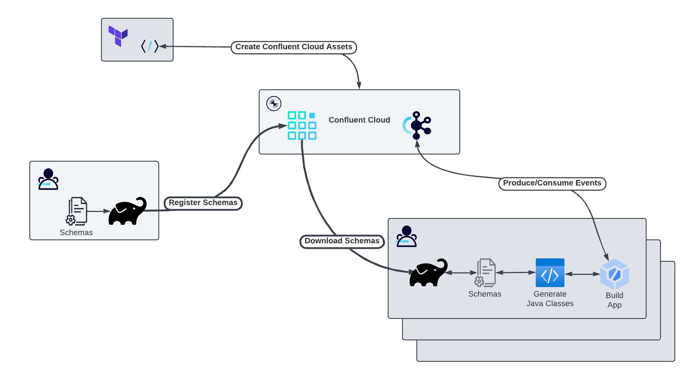
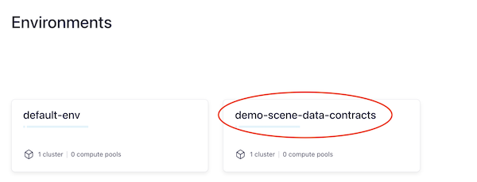
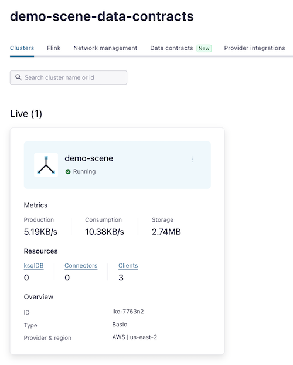
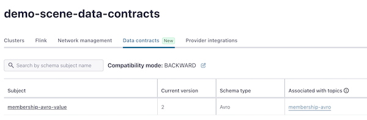

# Managing Data Contracts in Confluent Cloud

Data contracts consist not only of the schemas to define the structure of events, but also rulesets allowing for more fine-grained validations,
controls, and discovery. In this demo, we'll evolve a schema by adding migration rules.

I'd like to credit my colleague Gilles Philippart's work as the basis for the schemas and rules in this demo. My goal here is to add examples with commonly used
developer tools and practices to his work in this area, which can be found [here in GitHub](https://github.com/gphilipp/migration-rules-demo).

## Running the Example



In the workflow above, we see these tools in action:
* The [Confluent Terraform Provider](https://registry.terraform.io/providers/confluentinc/confluent/latest/docs) is used to define Confluent Cloud assets (Kafka cluster(s), Data Governance, Kafka Topics, and Schema Configurations).
* Using the newly created Schema Registry, data engineers and architects define the schema of the events that comprise the organization's canonical data model - i.e. entities, events, and commands that are shared across applications. - along with other parts of the data contract. This includes data quality rules, metadata, and migration rules. This is the `schemas` Gradle module: it owns the Avro schemas and rules for every major version, and registers each version with Schema Registry via its own independent Gradle task (`registerSchemasV1`, `registerSchemasV2`) rather than one task that registers everything at once - so each version's registration can be demoed on its own.
* Applications which produce and/or consume these event types (`app-schema-v1`, `app-schema-v2`) don't own any schema source themselves. Each downloads the specific version it builds against from Schema Registry using the same gradle plugin's `download` task, after which another gradle plugin generates Java classes from the downloaded schema - thus providing the application with compile-time type safety. This mirrors a real CI/CD relationship: the `schemas` module is the architects'/engineers' side of the contract, and the `app-schema-v*` modules are independent developer teams consuming whichever published version they target.

### Prerequisites

Clone this repository and `cd` into it:

```shell
git clone <this-repo-url>
cd data-contracts
```

Here are the tools needed to run this tutorial:
* [Confluent Cloud](http://confluent.cloud)
* [Confluent CLI](https://docs.confluent.io/confluent-cli/current/install.html)
* [Terraform](https://developer.hashicorp.com/terraform/install?product_intent=terraform)
* [jq](https://jqlang.github.io/jq/)
* GNU Make (all of the steps below are run through the `Makefile` - see [MAKE_README.md](MAKE_README.md) for every available command)
* JDK 21
* IDE of choice

> The `./gradlew` wrapper is committed, so a separate Gradle install isn't required.

> When installing and configuring the Confluent CLI, include the Confluent Cloud credentials as environment variables for future use. For instance with bash or zsh, include these export statements:
> 
> ```shell
> export CONFLUENT_CLOUD_API_KEY=<API KEY>
> export CONFLUENT_CLOUD_API_SECRET<API SECRET>
> ```
>

Terraform can use the value of any environment variable whose name begins with `TF_VAR_` as the value of a terraform variable of the same name. For more on this functionality, see the [terraform documentation](https://developer.hashicorp.com/terraform/cli/config/environment-variables#tf_var_name).

Our example requires we set the value the `org_id` variable from Confluent Cloud. This denotes which organization will house the Confluent Cloud assets we are creating. So let's export the Confluent Cloud organization ID to a terraform environment variable.

This command may open a browser window asking you to authenticate to Confluent Cloud. Once that's complete, the result of
`confluent organization list` is queried by `jq` to extract the `id` of the current organization to which you are authenticated:

```shell
export TF_VAR_org_id=$(confluent organization list -o json | jq -c -r '.[] | select(.is_current)' | jq '.id')
```

### Create Assets in Confluent Cloud

From the root of this repository, run:

```shell
make setup-cloud
```

This provisions the Confluent Cloud environment, Kafka cluster, and Schema Registry via Terraform, then writes
`shared/src/main/resources/confluent.properties` with the connection details your Kafka clients need. Because it's
provisioning real cloud resources, it may take a few minutes to complete.

Let's have a look at what we've created in Confluent Cloud, we find a new Environment:



With a Kafka cluster:



And Data Contracts:




Locally, we also create a `properties` file containing the parameters needed for our Kafka clients to connect to Confluent Cloud. For an example of this 
`properties` file, see [confluent.properties.orig](shared/src/main/resources/.confluent.properties.template).

> **NOTE**: The file-based approach we're using here is NOT recommended for a production-quality application. Perhaps a secrets manager implementation would be better suited - which the major cloud providers all offer, or perhaps a tool like Hashicorp Vault. Such a tool would also have client libraries in a Maven repository for the JVM applications to access the secrets.
> 

#### Using a local Kafka/Schema Registry stack instead of Confluent Cloud

The schema register/download Gradle tasks and the `app-schema-v1` producer/consumer aren't pinned to Confluent Cloud — they load their connection info from
whichever properties file you point them at. To run against a self-hosted Kafka + Schema Registry (docker/podman or otherwise), copy
[local.properties.orig](shared/src/main/resources/.local.properties.template) to `shared/src/main/resources/local.properties`, fill in your stack's
`bootstrap.servers`/`schema.registry.url` (a local registry typically needs no `basic.auth.*` credentials), then:

- Gradle schema register/download tasks: pass `-PschemaRegistryConfig=local.properties`, e.g. `./gradlew :schemas:registerSchemasV1 -PschemaRegistryConfig=local.properties`.
- The `app-schema-v1` producer/consumer: pass `-p /local.properties` on the command line.

Omitting these flags keeps the default behavior of using `confluent.properties` (Confluent Cloud).

### Register + Build Schema v1

Before running `app-schema-v1`, its schema needs to be registered with Schema Registry and the module built. One
command does both (registration first, since the build downloads whatever is currently registered):

```shell
make bootstrap-v1
```

Under the hood this runs `make register-schemas-v1` (registers `membership_v1.avsc` + its metadata from the
`schemas` module) followed by `make build-v1` (which downloads the registered v1 schema and compiles
`app-schema-v1` against it).

### Run the v1 Demo

`app-schema-v1` has separate commands for running a consumer or a producer independently - ideal for a conference
demo where you want them in separate terminal windows.

**Terminal 1 - Consumer:**

```shell
make demo-consumer-v1
```

This subscribes to the `membership-avro` topic and displays events using version 1 of the membership schema:

```shell
*** Starting Consumer using Schema v1!!!
[Thread-0] INFO io.confluent.devrel.datacontracts.shared.BaseConsumer - Received Membership d0e65c83-b1c5-451d-b08b-8d1ed6fca8d6, {"user_id": "d0e65c83-b1c5-451d-b08b-8d1ed6fca8d6", "start_date": "2023-01-14", "end_date": "2025-05-28"}
[Thread-0] INFO io.confluent.devrel.datacontracts.shared.BaseConsumer - Received Membership 940cf6fa-eb12-46af-87e8-5a9bc33df119, {"user_id": "940cf6fa-eb12-46af-87e8-5a9bc33df119", "start_date": "2023-05-23", "end_date": "2025-07-02"}
```

**Terminal 2 - Producer:**

```shell
make demo-producer-v1
```

By default, the producer sends one event per second for 10 seconds. Override either with make variables:

```shell
# Produce events every 2 seconds for 60 seconds
make demo-producer-v1 PRODUCER_INTERVAL_MS=2000 PRODUCER_DURATION=60
```

> Every `make demo-consumer-*`/`make demo-producer-*` run first checks that `confluent.properties` exists (from
> `make setup-cloud`) and fails fast with a clear message if it's missing, instead of a raw stack trace.
> Consumer group ids also get a unique per-run suffix, so re-running a consumer always starts fresh from the
> earliest offset - see `make demo-full` for all overridable parameters.

### Evolve the Schema: v1 → v2

Now provision and build schema v2, which restructures the flat `start_date`/`end_date` fields into a nested
`validity_period { from, to }` record - a change that is **not** backward compatible under standard Avro rules.
Schema Registry's migration rules (registered as part of v2, see `schemas/src/main/rules/membership_migration.json`)
are what let a v2 consumer transform v1 events on the fly:

```shell
make bootstrap-v2
```

Open three terminals to see the evolution in action - a v1 consumer for comparison, a v2 consumer that will
transparently migrate incoming v1 events, and a v1 producer that has no idea v2 even exists:

**Terminal 1 - v1 Consumer (for comparison):**

```shell
make demo-consumer-v1
```

**Terminal 2 - v2 Consumer (shows migration):**

```shell
make demo-consumer-v2
```

**Terminal 3 - Producer (still producing v1 events):**

```shell
make demo-producer-v1
```

The v2 consumer receives the same events the v1 producer sent using `major_version=1`, but transforms them to the
v2 shape automatically via the migration rule:

```shell
[Thread-0] INFO io.confluent.devrel.datacontracts.shared.BaseConsumer - v2 - Received Membership b0e34c68-208c-4771-be19-79689fc9ad28, {"user_id": "b0e34c68-208c-4771-be19-79689fc9ad28", "validity_period": {"from": "2022-11-06", "to": "2025-09-03"}}
[Thread-0] INFO io.confluent.devrel.datacontracts.shared.BaseConsumer - v2 - Received Membership 517f8c7e-4ae5-47ea-93a2-c1f00669d330, {"user_id": "517f8c7e-4ae5-47ea-93a2-c1f00669d330", "validity_period": {"from": "2023-01-29", "to": "2025-02-19"}}
```

This illustrates how migration rules let producers and consumers each evolve their code and configuration on
their own schedule, without coordinating a synchronized cutover.

You can also run `make demo-producer-v2` in a fourth terminal to show v2-native events flowing alongside v1 ones,
consumed correctly by both the v1 and v2 consumers.

### Optional: Lay It All Out in tmux

Instead of opening terminals by hand, `make demo-tmux` builds a tmux session with a `build` window and the `v1-demo`
and `v2-evolution` windows above, panes split and labeled. Each pane's command is typed in but **not** run - press
Enter in a pane when you're ready to narrate it, so nothing fires before you're on that slide. Panes are also
color-coded so the audience can tell v1 from v2 at a glance: blue panes/borders are v1, green panes are v2, and a
window's border goes amber whenever both versions are present in it side by side (`build`, `v2-evolution`):

```shell
make demo-tmux
```

Run `make demo-tmux-kill` afterward (or before a re-run) to tear the session down cleanly.

## Teardown

When you're done with the demo, destroy the Confluent Cloud environment:

```shell
make teardown-cloud
```

This prompts for confirmation before running `terraform destroy`, and on success also removes
`shared/src/main/resources/confluent.properties` - otherwise it would keep pointing at a cluster that no longer
exists, and `check-demo-ready` would wrongly consider the demo ready to run again. Check the Confluent Cloud
console afterward to confirm the environment no longer exists.
